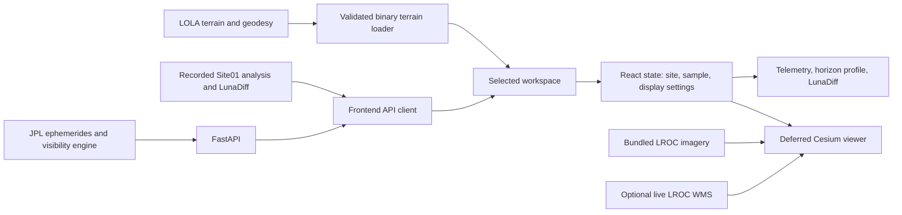

# Application architecture

`App.tsx` owns selection and timeline state. Async selection requests are sequenced; a slow old response cannot replace a newer selection. The client first attempts the API, then uses recorded Site01 fixtures for the supported observer. Arbitrary locations have an empty inspection view model, not a fabricated scientific response.

The main viewer is loaded through React lazy/Suspense. A viewer-only error boundary keeps the analysis UI available if that module or WebGL fails. Cesium allocates one viewer per mounted scene; effect cleanup destroys it and its input handler. Replacing a terrain patch removes the old primitive and wire collection.

## Scientific boundary

The lunar reference radius is 1,737,400 m. Terrain values are metres above that sphere, with MOON_ME_DE421 metadata. The decoder checks encoding, dimensions and checksum, removes faces adjoining nodata, and maps local +X east / +Y up / -Z north. The viewer converts local horizontal offsets to spherical geodesic positions and adds the declared radial heights.

Celestial vectors use azimuth clockwise from north. ENU direction is `(cos(el) sin(az), cos(el) cos(az), sin(el))`, transformed into Cesium fixed coordinates at the observer. Negative elevations remain negative. Vectors are rendered only when the real analysis matches terrain coordinates, frame, reference radius, elevation and selected observer height. The fixed recorded Site01 observer is 2 m above the declared surface.

The timeline selects existing UTC samples; it does not recompute ephemerides. Display exaggeration changes terrain visualization only. Vector lengths are illustrative. The local crop omits distant terrain used by the larger horizon engine, so the horizon chart is authoritative for recorded obstruction results; a local render is not a global shadow simulation.

## Delivery boundary

The static build contains recorded scientific data and real imagery. No API response is placed in the service-worker cache. The generated worker caches only versioned same-origin build files and provides an app-shell fallback for offline navigation. Optional external image tiles remain outside that cache. Netlify configuration serves a recorded-data frontend; it does not deploy Python or silently route `/api` calls to HTML.
