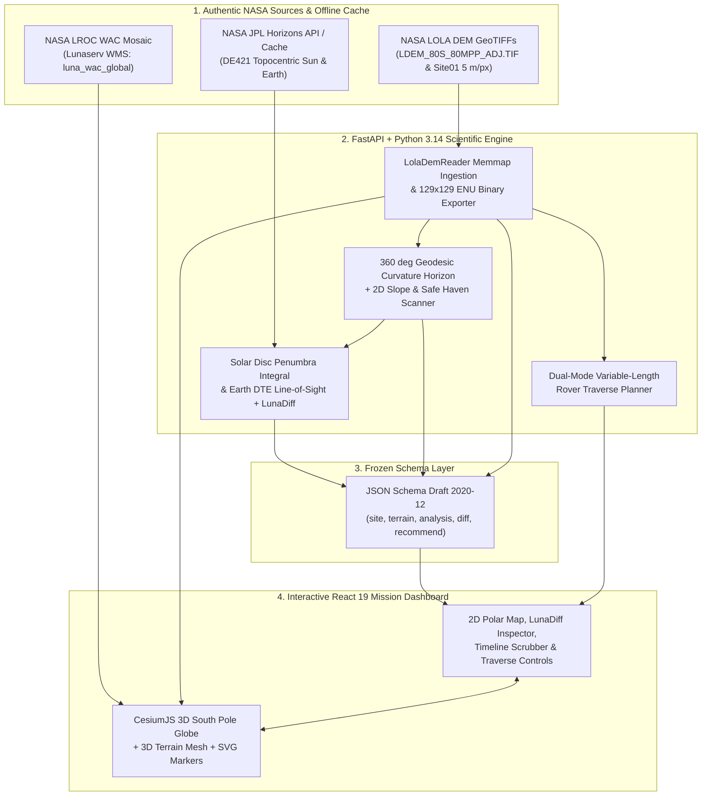

# HORIZON OPS (`LR-007`) — Project Documentation & Submission Reference

> **Purpose:** Complete, factually grounded reference answering the 12 core project documentation and hackathon/competition submission questions for **HORIZON OPS**, built on verified code, datasets, and test results in the `LR-007` repository.  
> **Note on Placeholders:** External URLs not yet published inside the repository (live deployed site URL, demo video link, slide deck link, and optional custom team display name) are marked with `[ADD_...]` placeholders so nothing is guessed or fabricated.

---

## Quick Submission Summary (At a Glance)

| Field | Answer |
| :--- | :--- |
| **1. Team Name** | **LR-007** *(or `[ADD_OFFICIAL_TEAM_DISPLAY_NAME]`)* |
| **2. Challenge / Problem Statement** | **NASA Space Apps Challenge — Lunar Landing Site Navigator** *(adaptable if submitting to a regional/national portal: `[ADD_LOCAL_CHALLENGE_TITLE_IF_APPLICABLE]`)* |
| **3. Project Name** | **HORIZON OPS** — *Lunar Landing Site, Mission Window, LunaDiff & Rover Traverse Navigator* |
| **4. Target Audience** | Built in **Sri Lanka** for the **world** — lunar mission planners, planetary scientists, aerospace researchers, and university/STEM students |
| **5. Source Repository** | [github.com/Abivarsan-Y/LR-007](https://github.com/Abivarsan-Y/LR-007) |
| **6. Demo Links** | Live App: `[ADD_LIVE_APP_URL]` · Video: `[ADD_DEMO_VIDEO_URL]` · Slides: `[ADD_SLIDES_URL]` |

---

## 1. Team Name

* **Team Identifier:** **LR-007** *(Repository & project code name: `LR-007`)*
* **Display Team Name (if using a custom team name on the portal):** `[ADD_TEAM_DISPLAY_NAME_OR_USE_LR-007]`
* **Team Structure (4-Member Engineering Split):**
  * **Member A (`[ADD_NAME]`):** JPL Horizons Ephemeris Ingestion & Replay Cache, Solar Disc Penumbra & DTE Visibility Math, **LunaDiff** Differential Engine, Backend API Integration.
  * **Member B (`[ADD_NAME]`):** NASA LOLA GeoTIFF Terrain Ingestion, 360° Curvature-Aware Horizon Profiler, Touchdown Slope Safety & Safe Haven Recommender, **Dual-Mode Variable-Length Rover Traverse Planner**, DEM Preparation Pipeline.
  * **Member C (`[ADD_NAME]`):** React 19 Mission Dashboard, Interactive 2D Polar Map, Synchronized Mission Timeline Scrubber, Traverse Controls & UI Integration.
  * **Member D (`[ADD_NAME]`):** Frozen JSON Schema Contracts (`contracts/*.schema.json`), 3D Terrain Binary Contracts, Validation Fixtures & Documentation Architecture.

---

## 2. Challenge Name / Problem Statement Selected

* **Challenge:** **NASA Space Apps Challenge — Lunar Landing Site Navigator** *(if submitting to a separate Sri Lankan/university hackathon track, add track name here: `[ADD_TRACK_NAME]`)*.
* **Problem Statement Summary:**
  Planning robotic landers and surface rovers at the **Lunar South Pole ($80^\circ\text{S} - 90^\circ\text{S}$)** is extraordinarily difficult because the Sun skims the horizon at only **$0^\circ - 1.5^\circ$** elevation, while Earth oscillates low near the northern sky over a **27.3-day libration cycle**. Crater rims 15–30+ km away cast long, dynamic shadows capable of triggering multi-day power blackouts (~70 hours) and sudden Direct-to-Earth (DTE) communication dropouts, while water-ice reserves sit inside steep, permanently shadowed craters (PSRs) where rovers risk tip-over slopes, battery depletion, and loss of radio line-of-sight back to the landed Base Pod. Missions need an interactive, scientifically traceable mission-planning tool to evaluate touchdown safety, compare launch-delay scenarios, explain *why* windows disappear, and plan safe traverses from sunlit Base Pods into PSR research targets.

---

## 3. Project Name

**HORIZON OPS**  
*Full Title:* **HORIZON OPS — Lunar Landing Site, Mission Window, LunaDiff & Rover Traverse Navigator**

---

## 4. What Does Your Project Do? (Simple Explanation)

**Simple Pitch:**  
**HORIZON OPS** is an interactive 3D lunar mission control and planning web application for the Moon's South Pole. It lets anyone click on real NASA elevation maps of the lunar south pole to check whether a spacecraft can land safely, see exactly when sunlight (solar power) and Earth communication signals will reach that spot, compare what breaks if a launch is delayed by 48 hours, and plan a safe rover driving route from a sunlit Base Pod into dark craters that hold water ice.

**Core Capabilities Implemented in the System:**

1. **Interactive 3D Globe & 2D Polar Map (`80°S–90°S`):**
   Combines a **CesiumJS** 3D lunar globe textured with NASA LROC Wide Angle Camera imagery, high-detail `129 × 129` (`20 m` spacing) ENU elevation patches, and an overhead 2D South Polar map with curated Artemis-era candidate sites and arbitrary click-anywhere coordinate picking.
2. **Instant Touchdown Slope Safety & Safe Haven Recommender:**
   Calculates local terrain steepness against Artemis / CLPS lander limits (**SAFE `< 8°`**, **CAUTION `8°–15°`**, **HAZARD `> 15°`**). If a chosen spot is too steep or shadow-trapped, clicking **Find Safe Haven** scans surrounding rings (`5–20 km` radius) to recommend the best nearby flat ridge.
3. **360° Curvature-Aware Solar Disc & Earth Communication Analysis:**
   Traces 360° terrain skylines around the observer accounting for lunar spherical curvature and computes time-stepped solar illumination fractions (partial solar disc penumbra, not just binary on/off) and Direct-to-Earth (DTE) line-of-sight using NASA JPL Horizons ephemerides.
4. **LunaDiff Engine (*"See what changed. See why."*):**
   Compares two mission windows side by side (e.g., **Nominal Launch** vs **+48h Delay**), highlighting every gained (green) and lost (red) sunlight or DTE communication window. Clicking any blackout window opens a causal 360° horizon profile pinpointing the exact ridge azimuth and elevation blocking the Sun or Earth.
5. **Dual-Mode Variable-Length Rover Traverse Planner:**
   Plans rover sorties from a landed **Base Pod** (`5 m` comms mast, hexagonal lander marker) toward selectable **Water-Ice PSR Craters**, **LCROSS impact sites**, **Mapped Rims**, or custom clicked coordinates (crosshair reticle marker):
   * **Manual Mode:** Suggests candidate next waypoints along variable step lengths (`0.45×`, `0.72×`, `1.00×`, `1.32×` nominal step + exact target snap up to `1.45×`), displaying remaining distance to target, slope band, solar disc visibility, Base Pod radio/optical LOS, and battery state-of-charge at every step.
   * **Automatic Mode:** Runs a single-click constrained pathfinder that builds the complete multi-waypoint route balancing slope safety (`≤ 15°`), battery backup (`≥ 20%` reserve of `1200 Wh`), solar recharge/dwell stops (`350 W` peak solar array vs `150 W` drive draw), switchbacks on steep terrain, and curvature-aware Base Pod LOS.
6. **Fail-Closed Provenance & Mission Export:**
   Never fabricates clear sky for missing elevation pixels (unknown DEM samples fail closed to `unknown` / `UNKNOWN`). Exports full mission plans to **JSON** or **CSV** with embedded SHA-256 provenance records.

---

## 5. What Problem Does It Solve?

| Challenge at the Lunar South Pole | How Conventional Tools Fall Short | How HORIZON OPS Solves It |
| :--- | :--- | :--- |
| **Grazing Sunlight (`0°–1.5°` Elevation)** | Simple average-sunlight maps hide continuous 70-hour freezing blackouts caused by distant crater rims 15–30+ km away. | Computes chronological solar disc penumbra fraction timelines over 14 days (30-min cadence) against 360° terrain horizons. |
| **Flat-Plane Geodesy Errors** | Ignoring lunar curvature causes false terrain blockage over long distances (at `20 km`, lunar curvature drops terrain by `~115.1 m`). | Applies exact spherical curvature drop ($\Delta z = \sqrt{R^2 + d^2} - R \approx d^2 / (2R_{moon})$ with $R_{moon} = 1,737,400\,\text{m}$) along true geodesic bearings (`pyproj.Geod`). |
| **Intermittent Direct-to-Earth (DTE) Comms** | Treating comms as static ignores Earth's 27.3-day libration wobble near the northern horizon. | Evaluates dynamic Earth azimuth/elevation from JPL Horizons DE421 against the local 360° terrain horizon at every timestep. |
| **Launch Delay Blindness** | Re-running manual GIS workflows after a +24h/+48h launch slip is slow and obscures root cause. | **LunaDiff** computes differential gained/lost windows and links every lost interval directly to the obstructing mountain ridge azimuth. |
| **Lander-to-Ice Crater Rover Risk** | Fixed step-length paths overshoot targets or walk blindly into `>15°` crater walls, drained batteries, or Base Pod radio dead zones. | Variable-length adaptive stepping + target snapping avoids overshoot while enforcing slope (`≤15°`), battery reserve (`≥20%`), solar dwell recovery, and `5 m` Base Pod mast LOS. |
| **Data Opacity & Connectivity Fragility** | Unverified interpolations mask gaps; cloud-only tools fail offline during field tests or judging. | Preserves `NaN`/`unknown` gaps fail-closed and caches real NASA LOLA + JPL Horizons data locally for 100% offline operation. |

---

## 6. Who Is It For? (`Sri Lanka / World / Farmers / Students / Scientists etc.`)

* **Geographic Scope:** **Built in Sri Lanka for the World.**  
  HORIZON OPS is open-source planetary software engineered in Sri Lanka to serve the global space exploration and STEM community. Because it supports full **offline execution with locally cached NASA datasets**, researchers, classrooms, and hackathons in Sri Lanka and other developing regions can run real LRO LOLA & JPL Horizons simulations without high-bandwidth cloud infrastructure.
* **Primary Users:**
  1. **Lunar Mission Planners & Aerospace Engineers (Global):** Evaluating candidate Artemis / CLPS / robotic south-pole landing zones, quantifying launch-delay impacts, and sizing rover sorties into Permanently Shadowed Regions (PSRs).
  2. **Planetary Scientists & Geospatial Analysts:** Cross-checking 360° horizon silhouettes, slope hazard envelopes, and crater-floor PSR targets against NASA Moon Trek and LROC QuickMap.
  3. **University Engineering / Physics Students & STEM Educators (Sri Lanka & Worldwide):** Learning spherical lunar geodesy, ephemeris mechanics, solar penumbra physics, and constrained path planning in a visual, hands-on browser workspace.
* **Domain Note on Other Categories (e.g., Farmers):** HORIZON OPS is built specifically for **space exploration, planetary science, and aerospace education**, not agriculture. However, its underlying terrain slope classification, solar-obstruction modeling, and radio line-of-sight geometry share foundational techniques with terrestrial GIS and precision terrain mapping.

---

## 7. How Does It Work? (Step by Step)

### A. User Workflow (Step by Step)

1. **Select a Lunar South Pole Site or Click Any Point:**  
   Pick one of four mapped catalog sites (**Connecting Ridge [Site 01]**, **Shackleton Crater Rim [Site 04]**, **Malapert Mountain [Site 07]**, **Haworth Crater Interior [Site 09]**) or click any coordinate on the 3D CesiumJS globe or 2D Polar Map (`80°S–90°S`).
2. **Inspect Touchdown Slope & Divert to a Safe Haven:**  
   HORIZON OPS evaluates elevation and slope immediately (`SAFE < 8°`, `CAUTION 8°–15°`, `HAZARD > 15°`). If the spot falls on a steep crater wall or shadow trap, click **Find Safe Haven** to locate safer flat ridges within `5–20 km`.
3. **Analyze Solar Power & Direct-to-Earth Visibility Over Time:**  
   View the 14-day timeline (`30 min` steps) of solar disc exposure (`0%–100%`) and Earth DTE link availability, plus metrics such as total sunlit hours, maximum continuous darkness duration, and communication availability.
4. **Run LunaDiff (+48h Delay Comparison) & Causal Inspector:**  
   Compare **Scenario A (Nominal)** vs **Scenario B (+48h Launch Delay)**. Inspect the differential timeline bars (**Green = Gained**, **Red = Lost**) and click any lost blackout window to open the **360° Horizon Profile**, highlighting the exact blocking ridge azimuth and angle.
5. **Scrub the Synchronized 3D Mission Clock:**  
   Drag the mission timeline slider to watch the Sun azimuth/elevation shift across the horizon and inspect 3D horizon rays in real time.
6. **Plan a Rover Traverse to a Research Target (Manual or Auto):**
   * Select a **Target Research Point** from curated **Water-Ice PSR Craters** (`Shackleton Crater Floor (PSR)`, `Shoemaker Crater Floor (PSR)`, `Cabeus Crater Basin (LCROSS)`, `Faustini Crater Floor (PSR)`), **Mapped Rims & Cold Traps** (`de Gerlache Crater Rim & Cold Trap`, `Connecting Ridge`, `Shackleton Rim`, `Malapert Mountain`, `Haworth Interior`), or click **Pick on 3D Globe**.
   * Choose **Manual Mode** to evaluate adaptive variable-length candidate hops and advance step by step with live distance-to-target readouts, or **Automatic Mode** to compute a complete safe route with solar recharge/dwell stops.
7. **Export Mission Package:**  
   Download the verified mission analysis and route timeline as **JSON** or **CSV** with embedded SHA-256 provenance metadata.

### B. Technical Pipeline Architecture (Under the Hood)



**Key Mathematical Models Implemented:**
* **Reference Frame & Sphere:** `MOON_ME_DE421`, mean lunar radius $R_{moon} = 1,737,400\,\text{m}$.
* **Spherical Curvature Drop:** $\Delta z_{drop}(d) = \sqrt{R_{moon}^2 + d^2} - R_{moon} \approx \frac{d^2}{2 R_{moon}}$ along `pyproj.Geod` lunar sphere geodesics.
* **Extended Solar Disc Penumbra:** Normalized center clearance $u = c / r_{sun}$; full eclipse $u \le -1 \Rightarrow 0$, full disc $u \ge 1 \Rightarrow 1$, penumbra $-1 < u < 1 \Rightarrow \frac{\arccos(-u) + u\sqrt{1 - u^2}}{\pi}$.
* **Rover Physical Constraints (`backend/terrain/traverse.py` & `frontend/src/api/client.ts`):**
  * Rover mast: `2.0 m` · Base Pod mast: `5.0 m`
  * Max traversable slope: `15.0°` (`SAFE < 8°`, `CAUTION 8°–15°`, `HAZARD > 15°`)
  * Battery capacity: `1200.0 Wh` · Minimum reserve floor: `20%` (`240.0 Wh`)
  * Drive power draw: `150.0 W` · Speed: `0.5 m/s` · Peak solar array output: `350.0 W`
  * Adaptive variable step radial factors: `[0.45, 0.72, 1.0, 1.32]` plus direct snap to target (`≤ 1.45×` step distance)

---

## 8. What Tools / Technologies Did You Use?

*Exact packages and versions verified in [`backend/pyproject.toml`](../backend/pyproject.toml), [`frontend/package.json`](../frontend/package.json), and CI workflows:*

| Layer | Technologies Used |
| :--- | :--- |
| **Application Type** | Full-Stack Web Application (**React SPA + FastAPI REST API**) with offline static client computation fallback |
| **Frontend Stack** | **React 19.2**, **TypeScript 5.9**, **Vite 7.2**, **Tailwind CSS 4.1**, **CesiumJS (`cesium ^1.147`)** for 3D planetary globe & tactical SVG overlays, **Three.js (`^0.181`)** & **`@react-three/fiber` (`^9.4`)**, **Recharts (`^3.0`)**, **Lucide React (`^0.468`)** |
| **Backend & Scientific Python** | **Python 3.14**, **FastAPI (`>=0.162.7`)**, **Pydantic v2 (`>=2.12`)** & **Pydantic Settings**, **Uvicorn (`>=0.54`)**, **NumPy (`>=2.1`)**, **SciPy (`>=1.10`)**, **PyProj (`>=3.5`)**, **Rasterio (`>=1.5.2`)**, **Tifffile (`>=2026.11`)**, **ImageCodecs (`>=2026.11`)** |
| **Data Contracts & Testing** | **JSON Schema Draft 2020-12** (`jsonschema 4.25.1`), **Pytest (`>=9.2`)**, `httpx2`, **Node.js built-in Test Runner (`node --test`)** |
| **Version Control & CI/CD** | **Git & GitHub**, **GitHub Actions CI** ([`backend-ci.yml`](../.github/workflows/backend-ci.yml), [`contracts-ci.yml`](../.github/workflows/contracts-ci.yml)) |
| **Note on AI / ML** | **Not an ML black box.** All horizon ray-casting, geodesy, ephemeris calculations, solar penumbra integrals, LunaDiff diffs, and A*-style constrained rover traverses are **deterministic scientific/geometric algorithms**. |

**Verified Automated Quality Checks (Run on Current Repository):**
* Backend scientific & API test suite (`pytest backend/tests/`): **145 passed**
* Contract schema conformance tests (`tests/test_contracts.py`): **8 passed**
* Frontend scene, lunar math & terrain decoding tests (`npm --prefix frontend test`): **23 passed**
* Frontend TypeScript check & production bundle (`npm --prefix frontend run build`): **Passed cleanly (`tsc --noEmit && vite build`)**

---

## 9. Which NASA Data Did You Use? (Dataset Names)

Every scientific number in HORIZON OPS traces back to authentic NASA planetary products recorded in provenance manifests (`data/sites.json`, `data/processed/*`, `backend/tests/fixtures/science/site01/`):

1. **NASA LRO LOLA South Polar Digital Elevation Model — 80°S to 90°S (`LDEM_80S_80MPP_ADJ.TIF` / `LDEM_80S_20MPP_ADJ.TIF`)**
   * **Mission / Instrument:** Lunar Reconnaissance Orbiter (LRO) — Lunar Orbiter Laser Altimeter (LOLA)
   * **Archive Source:** NASA GSFC Planetary Geodynamics Data Archive (**PGDA Product 90** — `https://pgda.gsfc.nasa.gov/products/90`, `https://pgda.gsfc.nasa.gov/data/LOLA_20mpp/LDEM_80S_20MPP_ADJ.TIF` and `LDEM_80S_80MPP_ADJ.TIF`)
   * **Use in Project:** Full South Polar regional terrain elevation grid (`7,600 × 7,600` float32 raster in the `80 m/pixel` DEM), curvature horizon ray-casting, slope evaluation, Safe Haven scanning, and rover traverse routing.

2. **NASA LRO LOLA High-Resolution 5 m/pixel Polar Site DEM (`Site01_final_adj_5mpp_surf.tif` & Quality Layers)**
   * **Archive Source:** NASA GSFC **PGDA Product 78** (`https://pgda.gsfc.nasa.gov/data/LOLA_5mpp/Site01/Site01_final_adj_5mpp_surf.tif` plus `_ldec.tif`, `_slp.tif`, `_toterr.tif`, `_slperr.tif`)
   * **Use in Project:** Fine near-field topography (`5 m/pixel`), uncertainty inspection, and canonical Connecting Ridge (`Site 01`) skyline horizon generation combined with the 20 m polar DEM fallback.

3. **NASA JPL Horizons On-Line Ephemeris System (`https://ssd.jpl.nasa.gov/api/horizons.api`)**
   * **Ephemeris Model / Frame:** JPL **DE421** in Lunar Mean-Earth / Polar Axis (**`MOON_ME_DE421`**), topocentric observer on Moon surface (`@301`)
   * **Targets & Quantities:** **Sun (`NAIF 10`)** and **Earth (`NAIF 399`)**, Horizons observer quantities **4** (apparent azimuth & elevation), **13** (equatorial angular diameter in arcseconds), and **20** (apparent range)
   * **Use in Project:** Ground-truth solar and Earth sky tracks over 14-day windows (`2026-11-15T00:00:00Z` nominal and `+48h` delayed runs) cached with SHA-256 checksums for deterministic offline replay.

4. **NASA / GSFC / ASU LROC Wide Angle Camera (WAC) Global Mosaic (`luna_wac_global`)**
   * **Service:** Lunaserv Web Map Service (`https://wms.im-ldi.com/`, layer `luna_wac_global`, projection `IAU2000:30100`)
   * **Use in Project:** Draped high-contrast optical albedo surface layer across the CesiumJS 3D South Polar globe.

5. **NASA Reference Portals for Ground-Truth Cross-Verification & External Linking:**
   * **NASA Moon Trek** (`https://trek.nasa.gov/moon/`) — External feature and line-of-sight cross-verification
   * **LROC QuickMap** (`https://quickmap.lroc.im-ldi.com/`) — Deep-linked directly from the UI to selected site coordinates

---

## 10. Any Other Data Used?

Yes — the following engineering catalogs, partner portals, and verification fixtures complement the raw NASA elevation and ephemeris products:

1. **Curated Artemis-Era Candidate Sites & Water-Ice PSR Research Targets (Internal Engineering Catalogs):**
   * **4 Landing Sites ([`data/sites.json`](../data/sites.json)):** Connecting Ridge (Site 01), Shackleton Crater Rim (Site 04), Malapert Mountain (Site 07), Haworth Crater Interior (Site 09).
   * **Water-Ice PSR Craters & Polar Landmarks ([`frontend/src/api/client.ts`](../frontend/src/api/client.ts)):** Shackleton Crater Floor (PSR), Shoemaker Crater Floor (PSR), Cabeus Crater Basin (LCROSS plume discovery crater), Faustini Crater Floor (PSR), and de Gerlache Crater Rim & Cold Trap.
2. **Representative Spacecraft & Rover Engineering Parameters:**
   * Touchdown slope stability criteria (`< 8°` SAFE, `8°–15°` CAUTION, `> 15°` HAZARD) aligned with Artemis HLS / CLPS lander envelopes.
   * Representative rover engineering model (`2.0 m` rover mast, `5.0 m` Base Pod mast, `1200 Wh` battery, `20%` reserve floor, `150 W` drive power, `350 W` peak solar array, `0.5 m/s` cruise speed).
3. **Canadian Space Agency (CSA) Moon Exploration Portal (`https://www.asc-csa.gc.ca/eng/astronomy/moon-exploration/`):**
   * Linked inside the dashboard external references panel as an Artemis partner science resource.
4. **Controlled Synthetic Verification Fixtures (`data/fixtures/`):**
   * Analytical test baselines (e.g., smooth sphere horizon dip benchmarks and mock contract fixtures) strictly tagged `provenance.data_kind = "synthetic"` for automated unit and schema tests — never mixed into real landing-site outputs.

---

## 11. Did You Use AI Tools? (`ChatGPT, Cursor, Copilot, etc.`)

**Yes — transparently and strictly for development productivity, not scientific inference.**

* **Where AI Coding Assistants Were Used:**  
  AI assistants (such as **Antigravity / LLM coding assistants**) were used during development to accelerate React/TypeScript UI component scaffolding, CesiumJS tactical overlay styling/SVG icons, boilerplate FastAPI endpoint wiring, unit test authoring, and organizing technical documentation.
* **What Was NOT Delegated to AI:**  
  No generative AI or LLM runs inside the physics, ephemeris, or planning loops. All planetary math (polar stereographic projection, spherical curvature drop, 360° horizon ray-casting, circular-segment solar penumbra integration, LunaDiff differential logic, and slope/battery/LOS traverse planning) is implemented as deterministic Python and TypeScript algorithms and validated against analytical formulas and **176 automated tests** (`145` backend + `8` schema contract + `23` frontend tests).

**Copy-Paste AI Disclosure Statement (Short Portal Version):**
> *"Generative AI coding assistants were used during development to assist with UI scaffolding, boilerplate API integration, unit test authoring, and documentation formatting. Zero AI models are used at runtime to generate scientific estimates: all elevation ingestion, lunar spherical curvature equations, JPL Horizons ephemeris replay, solar penumbra visibility calculations, LunaDiff comparisons, and rover traverse pathfinding execute through deterministic physics/geometric code validated by 176 automated tests and NASA source provenance hashes."*

---

## 12. Do You Have a Demo Link? (Video / Slides / Website)

Fill in the public links below once uploaded/deployed and verified in an Incognito browser window:

| Deliverable | Link / Status | Notes |
| :--- | :--- | :--- |
| **Source Code Repository (Verified)** | [https://github.com/Abivarsan-Y/LR-007](https://github.com/Abivarsan-Y/LR-007) | Active development branch: `phase-5/b-rover-traverse` *(ensure repo visibility is **Public** before submission)* |
| **Live Web Demo (Website)** | `[ADD_LIVE_DEPLOYED_WEBSITE_URL]` | E.g., Vercel/Netlify static build (runs standalone offline mode automatically when backend API is offline) or full FastAPI + Vite deployment |
| **Video Demo (90–120 sec Pitch)** | `[ADD_YOUTUBE_OR_VIMEO_DEMO_URL]` | Set privacy to **Public** or **Unlisted** (never Private); storyboard outline is available in [`DOCUMENTATION_GUIDE.md`](./DOCUMENTATION_GUIDE.md) |
| **Presentation Slides** | `[ADD_GOOGLE_SLIDES_OR_PDF_URL]` | Set sharing permissions to *"Anyone with the link can view"* |

### Local Quickstart (If Evaluators Run Locally)

```bash
# Terminal 1 — Start Scientific FastAPI Backend
uvicorn backend.app.main:app --reload

# Terminal 2 — Start React + CesiumJS Frontend
npm --prefix frontend ci
npm --prefix frontend run dev
```

*(Note: Even without the backend running, the frontend automatically provides offline evaluation capabilities for catalog sites, local 129×129 DEM terrain meshes, and rover traverse planning.)*

---

## Pre-Submission Final Checklist for the Team

- [ ] Replace `[ADD_...]` placeholders in Sections 1, 2, and 12 with your final display team name, track title (if applicable), video link, slide deck link, and live website URL.
- [ ] Verify GitHub repo [Abivarsan-Y/LR-007](https://github.com/Abivarsan-Y/LR-007) is **Public** and default/submission branch is up to date.
- [ ] Test every demo link in a fresh Incognito/Private browser tab before submitting.
- [ ] Optionally copy the `## 4–12` answers into the portal submission fields and follow [`docs/DOCUMENTATION_GUIDE.md`](./DOCUMENTATION_GUIDE.md) for any additional deep-dive technical docs (`sources.md`, `methodology.md`, `architecture.md`).
