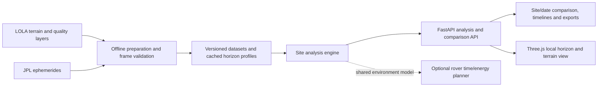

# LR-007 architecture audit

Reviewed 14 November 2026. Source: `notes/mission_architecture_and_discussion_notes.md` at `61af012a5460600acd4817059e4f5d0d67fce236` on `origin/main`. Line references below refer to the [architecture document at that commit](https://github.com/Abivarsan-Y/LR-007/blob/61af012a5460600acd4817059e4f5d0d67fce236/notes/mission_architecture_and_discussion_notes.md), independently of the current branch contents. The repository contains documentation only; these are design findings, not observed implementation defects. No benchmark or mission simulation was run.

## Verdict

Keep FastAPI, NumPy/SciPy, Three.js, LOLA terrain, and JPL ephemerides. Revise the product scope and numerical contracts before implementation. The proposed stack is suitable for a prototype; it does not establish the correctness or performance of the mission model.

The most consequential issue is challenge alignment. The [official Space Apps challenge summary](https://www.spaceappschallenge.org/2026/challenges/lunar-landing-site-navigator/) asks for rapid comparison of landing locations and dates, with Sun/Earth horizon visualizations and power/communication opportunities. The current document instead makes a single-location rover simulator its main product. The indexed official summary was accessible; direct retrieval of the detailed challenge page failed. This report does not claim to have checked every detailed challenge provision or judging criterion.

Priority P1 means resolve before relying on scientific results or committing to the proposed implementation. P2 means address in the prototype design or defer the affected feature explicitly.

## Findings

### 1. P1 — The main workflow does not answer the challenge's central comparison question

**Source:** lines 3–17, 61–105, 138–162.

Shackleton sorties, rover deployment, relay links, battery rescue, and cinematic camera transitions occupy the plan. It does not specify a multi-site comparison model, date-comparison workflow, horizon chart, or clear summary of visibility windows. Building the proposed roadmap could deliver an elaborate rover demonstration without allowing a user to choose between two landing options.

**Correction:** make the core journey: select sites → choose a date range and observer height → compare terrain horizons, Sun/Earth tracks, illumination opportunities, longest darkness and Earth-occlusion intervals → inspect assumptions and export results. Start with several curated south-polar sites covered by the selected terrain data; Shackleton is a preset. Define how custom coordinates outside data coverage are handled. Treat rover planning and heliostat demonstrations as later extensions. This is a recommendation based on the available challenge summary, not an assertion that optional extensions are prohibited.

### 2. P1 — Coordinate frames, height references, and time conventions are unspecified

**Source:** lines 15, 43–46, 64, 78, 113–116, 144.

The document mixes polar stereographic rasters, local lander coordinates, Moon/Earth Cartesian positions, and observer azimuth/elevation without defining their transforms. A misplaced east/west longitude sign or mismatched lunar frame can produce plausible scenes with wrong visibility. The lander's `(0,0,0)` is a useful local origin but cannot replace global georeferencing.

**Correction:** define one scientific coordinate contract covering longitude convention, planetocentric latitude, raster CRS/affine transform, reference radius and elevation, pixel centers, lunar frame realization, SI units, and explicit UTC/internal ephemeris time conversions. Store the lander's global position and derive a local east/north/up basis. Handle polar basis conventions explicitly. Transform ephemerides into a frame compatible with the DEM before computing directions; record geometric/apparent and light-time conventions.

**Evidence:** [PGDA product 90](https://pgda.gsfc.nasa.gov/products/90) specifies polar stereographic coordinates in meters and the DE421 MOON_ME frame, and provides uncertainty/effective-resolution products. The [Horizons manual](https://ssd.jpl.nasa.gov/horizons/manual.html) documents longitude, time scales, and lunar orientation models. Matching a frame name alone is insufficient without checking its realization and transformation assumptions.

### 3. P1 — Visibility requires a horizon engine, not only a local terrain raycast

**Source:** lines 29–34, 72, 78, 113–121.

At the south pole, Sun and Earth can graze distant terrain horizons. A cropped crater mesh may omit the ridge that actually blocks a target. A flat heightfield approximation also neglects lunar curvature over longer distances. Hourly samples can miss short visibility or shadow events. A permanent-shadow map is not an instantaneous illumination time series.

**Correction:** build a reusable azimuth-dependent horizon profile for each site and observer height, with local high-resolution terrain and sufficient surrounding lower-resolution coverage. Use lunar Cartesian geometry or a validated curvature treatment; require coverage checks and convergence as the horizon radius increases. Represent unknown terrain separately from clear sky. Compute Sun/Earth altitude against that profile, account for the finite solar disc when estimating illumination, and state whether Earth visibility uses the center, part of the disc, or a station. Use adaptive event refinement plus timestep-convergence checks, including grazing events. Report uncertainty near the horizon.

**Evidence:** [PGDA polar illumination products](https://pgda.gsfc.nasa.gov/products/69) distinguish illumination statistics and permanent-shadow products. They should be reference checks with matched assumptions, not substitutes for date-specific geometry.

### 4. P1 — A static A* grid cannot support the proposed time/battery guarantees

**Source:** lines 55, 76–80, 95–105, 145, 160.

Two visits to the same position at different times or battery levels are not equivalent. A route valid at departure can enter shadow later; reaching a bright cell does not imply a net energy gain. There is no rover speed, power, charging, battery, or thermal model. Checking only the endpoint at a nominal return time does not establish a feasible return journey.

**Correction if rover planning is retained:** specify states such as `(cell, time, usable battery)` with drive, wait, and charge actions. Model elapsed time, panel area/orientation/efficiency, illumination fraction, drive/electronics/radio/heater loads, charging losses, battery bounds, and reserve. For example, integrate `dE/dt = P_charge - P_drive - P_payload - P_radio - P_heater`, with consistent units and operating modes. Evaluate constraints throughout edges and waits. Treat unsafe slopes, insufficient battery, and required connectivity as hard constraints rather than optional penalties. Validate a small reference resource-constrained search before optimizing or applying dominance pruning.

Any return boundary must depend on time, energy, vehicle parameters, and model uncertainty; it need not be circular. Describe it as model-estimated return feasibility. A permanently shadowed location may never receive the assumed future sunrise, and cold survival requires an actual thermal design. Remove unconditional hibernation and safe-extraction guarantees. For the challenge MVP, defer this entire subsystem until site analysis works.

### 5. P1 — Earth geometry, radio connectivity, and DSN service are conflated

**Source:** lines 23–34, 66–72, 146.

The DSN's distributed complexes do not establish that a particular lunar location has continuous Earth visibility, that a particular station is visible, or that an antenna is scheduled. Earth libration, local terrain, antenna pointing, and radio performance matter. Seeing part of Earth is different from having a usable path to an Earth station. The two-LOS equation is only a geometric prerequisite for the chosen relay scenario.

**Correction:** make direct-to-Earth geometric visibility the core challenge output. Keep rover→lander and lander→Earth as separate optional relay outputs. Label station visibility as predicted geometry and omit claimed real handoffs without operational schedule data. For a simulated radio link, specify endpoints and antenna heights, frequency, gains, pointing limits, transmit power, receiver sensitivity, required bitrate/margin, range loss, and terrain clearance/Fresnel effects as appropriate. A visible geometric path must not automatically mean live telecast.

**Evidence:** the [DSN telecommunications handbook](https://deepspace.jpl.nasa.gov/dsndocs/810-005/) is a valid engineering reference. [NASA SCaN](https://www.nasa.gov/communicating-with-missions/scan-enabling-moon-to-mars/) discusses the special communications challenges near the lunar south pole.

### 6. P2 — Heliostat rescue is a research concept without an optical/power budget

**Source:** lines 84–91, 104, 132–133, 152.

Vacuum avoids atmospheric attenuation but does not make reflected sunlight a laser. Mirror area, optical design, solar angular extent, pointing accuracy, receiver size and orientation, occlusion, and conversion losses govern delivered power. A basic unfocused mirror has an extended-source spot contribution of roughly 9 m across at 1 km for a 0.53° solar diameter; that estimate is not a bound for every engineered optical system. An apparently glowing beam through empty space would be an explanatory graphic, not a physically visible volumetric beam.

**Correction:** remove heliostat rescue from the feasibility/safety logic and label it experimental if retained visually. Require an explicit optical and electrical budget before using it to charge a rover in the model.

**Evidence:** [NASA Light Bender](https://www.nasa.gov/general/light-bender/) is a real concept involving specialized telescope optics, a Fresnel lens, and receiver arrays. It supports the research direction, not an automatic lander-mirror rescue capability. The two exact heliostat/ESA study titles in the repository remain unverified; do not present them as established citations without a matching publication.

### 7. P2 — Terrain pixel spacing is being treated as navigational certainty

**Source:** lines 43, 55, 113, 121.

A 20 m raster can support regional horizon analysis, but it cannot resolve every obstacle on a 10–50 m waypoint traverse. Raster-derived slopes are not a complete wheel-scale traversability model. A visually smooth interpolated surface does not add observations or establish safe descent into a steep crater.

**Correction:** state the scale of valid conclusions. Preserve no-data, sample-count, effective-resolution, and uncertainty layers. Use finer products where justified and available, and require vehicle/terrain constraints for route examples. Keep regional landing-site suitability distinct from rover obstacle avoidance and landing hazard certification.

**Evidence:** [PGDA product 90](https://pgda.gsfc.nasa.gov/products/90) confirms that the named 20 m elevation/slope/PSR products exist. [Product 81](https://pgda.gsfc.nasa.gov/products/81) offers a 5 m polar mosaic, and [product 78](https://pgda.gsfc.nasa.gov/products/78) includes Shackleton-rim coverage while documenting substantial interpolation in 5 m products. Smaller pixels do not by themselves remove terrain uncertainty.

### 8. P2 — Async HTTP and NumPy do not establish a 15 ms planner

**Source:** lines 50–57, 121, 142–146.

NumPy/SciPy accelerate suitable array operations; they do not automatically compile the branching/search logic of a custom A*. A long computation called directly from an async FastAPI endpoint can block its event loop. Cold data downloads, raster processing, horizon generation, and route search have different costs and failure modes.

**Correction:** keep a modular application, with offline dataset preparation, a small API, and a bounded execution path for heavy work. Use a worker process or equivalent isolation for expensive computation when needed; a distributed queue is not necessary for a small demo. Cache by input and model/data version. Bound coordinates, ROI, duration, timestep, concurrency, and output size; define cancellation and deadline behavior. Provide explicit `no feasible result`, `missing data`, `outside coverage`, `upstream failure`, and `deadline exceeded` responses.

Benchmark separate stages with documented hardware and workloads, including cold/warm caches, concurrent requests, worst-case searches, and peak memory. Replace 15 ms/zero-lag claims with measured targets. The absence of Maven in one environment is not a lasting architectural reason to rule out Java; Python is nevertheless a sensible integration choice here.

### 9. P2 — Two cameras do not solve GPU precision or terrain streaming

**Source:** lines 38–46, 113–121, 147–154.

Using two cameras does not itself fix large world coordinates, depth precision, terrain size, GPU memory, or render-thread stalls. Shipping a whole polar raster or a dense time-dependent illumination cube to the browser can dominate performance. For scale, a 20 km × 20 km ROI at 20 m spacing has one million cells; 721 hourly float32 fields occupy about 2.9 GB before overhead or additional variables.

**Correction:** render local surface coordinates relative to an origin, with an independently scaled orbital scene. Use terrain tiles, levels of detail, deliberate near/far planes, mesh/texture budgets, and disposal/cancellation of stale assets. Return compact site timelines and horizon profiles; stream derived visualization tiles as needed. Keep scientific visibility independent of Three.js shadow settings and visual terrain LOD. Coalesce time-slider requests and prevent stale responses from overwriting newer selections. Retain a usable chart/comparison view if 3D fails.

### 10. P2 — Reproducibility, validation, and result contracts are absent

**Source:** lines 55–57, 100, 113–116, 125–162.

Results cannot be reproduced from a dataset filename and an API endpoint name. The plan has no acceptance criteria for horizon accuracy, visibility events, energy accounting, or rendering/solver agreement. The citation table lacks enough bibliographic information to establish several named studies. The performance claims have no workload definition.

**Correction:** every analysis result should identify site coordinates and height, explicit time range/convention, sampling and event tolerance, dataset ID/hash, frame and ephemeris options, model version, assumptions, missing-data coverage, and numerical uncertainty. Use versioned cached source responses and datasets; keep the prepared demo functional when upstream NASA services are unavailable. For custom sites, explicitly report unavailable coverage instead of substituting invented values.

Define tests before implementation: frame round trips and known directions; flat and single-ridge horizons; curved-surface checks; no-data boundaries; low-angle grazing events; timestep/radius convergence; matched Horizons/SPICE or independent calculations; night/disc/long-blackout cases; deterministic exports; stale UI response handling; and bounded runtime/memory. If routing remains, add energy conservation, infeasible slope/relay cases, a charging wait, a changing shadow trap, and a return trip whose nominal shortcut becomes infeasible. These are proposed acceptance checks, not tests that have already passed.

Minor corrections: the average rotation relative to the Sun implied by 29.5 days is about 0.51°/hour, not 0.55°/hour; it should not replace ephemeris directions. Fix the duplicate section 4. Replace “exact,” “guaranteed,” and agency-validation wording with specific model assumptions and verifiable references.

## Recommended architecture

Use a modular monolith initially. Add infrastructure only when workload measurements justify it.

The analysis engine should contain pure scientific functions independent of HTTP and rendering: coordinate transforms; terrain sampling/horizons; body directions; visibility events; and optional solar-power estimation. FastAPI validates and schedules work. The frontend visualizes returned scientific results. Keep station operations and heliostat models outside the baseline engine.

Suggested modules: `datasets`, `frames`, `ephemeris`, `horizon`, `visibility`, `solar`, `analysis`, and `api`; optional later `routing`, `energy`, and `radio`. A file cache plus manifests is enough for a curated demo. Add persistence for user scenarios only when required.

Minimal API contract:

- `GET /api/sites`: curated sites, coordinates, data coverage and available terrain versions.
- `POST /api/analyses`: site selections/custom coordinates, start/end UTC, observer height, and explicit model options; return a result or a job ID according to bounded workload.
- `GET /api/analyses/{id}`: status, reproducible inputs, horizon profile, Sun/Earth tracks, event intervals, summary metrics and uncertainty. Include cancellation if jobs can outlive the request.
- `GET /api/analyses/{id}/export`: machine-readable results with the same provenance and units.

For the initial geometric model, useful metrics are sunlight fraction, longest continuous darkness, Earth-visible fraction, longest Earth occlusion, and overlap of sunlight/Earth visibility. Label solar power as an estimate with panel assumptions; do not turn illumination fraction into watts without a panel model. Present separate metrics before introducing user-weighted rankings, and explain any ranking formula.

## Delivery order and acceptance gates

1. **Scientific baseline:** choose a few sites; pin real terrain and ephemerides; document frames/units/time; validate horizons and body directions against reference cases. Cache the exact data used by the demo.
2. **Challenge workflow:** implement site/date comparison, local horizon charts, time-window metrics, provenance and CSV export. A viewer can explain why changing the date or site changes the result.
3. **3D presentation:** connect the validated results to the terrain/sky view; add local/orbital transitions and measure frame rate on a named target device. Verify rendered directions match the charts.
4. **Optional mission layer:** add one parameterized rover model and validated time/energy planning only after the baseline passes. Treat radio detail and heliostat research as separately scoped extensions.

There is no application code to test yet. This audit checked the repository document, the accessible official challenge summary, and the primary NASA/JPL references linked above. It did not certify a landing location, radio service, optical power system, thermal survival strategy, or performance target.
