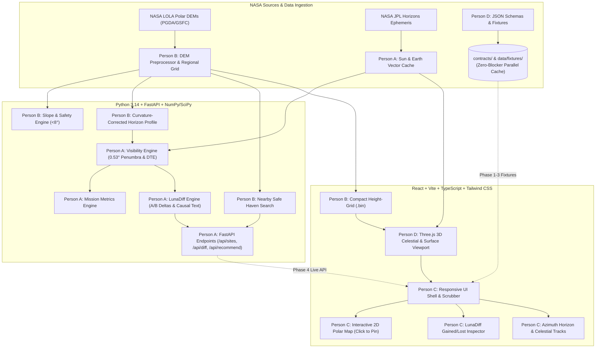

# HORIZON OPS — Master Unified Development Plan
## NASA Space Apps Challenge 2026: Lunar Landing Site Navigator

> **Project:** HORIZON OPS — Lunar Landing Site, Mission Window & LunaDiff Navigator  
> **Team:** 4 Developers (Person A, B, C, D)  
> **Timeframe:** ~39 Hours (5 Structured Phases × 4 Independent Work Packages = 20 PRs)  
> **Repository Strategy:** Protected `main`, branch-per-workpackage, contract-driven parallel execution  
> **Guiding Principle:** Truth before polish. Verified NASA science first, intuitive interactive explanation always.

---

## 1. Executive Summary & Challenge Solution

The core Space Apps Challenge asks: *"Where and when should we land at the Lunar South Pole to maximize mission success?"*

At the lunar south pole, the Sun never rises high—it creeps along the horizon at **$0^\circ$ to $1.5^\circ$ elevation**. Distant crater rims 15–30 km away cast long, moving shadows across potential landing sites, while Earth wobbles low along the southern horizon in a 27.3-day libration loop. A site with 80% sunlight may experience a catastrophic 70-hour blackout, while a site with less sunlight might offer continuous, uninterrupted direct-to-Earth communication.

**HORIZON OPS** solves this by providing:
1. **Interactive Touch & 3D Exploration**: A 3D Moon and 2D Polar Map ($85^\circ\text{S} - 90^\circ\text{S}$) with click/tap to analyze any location.
2. **Landing Hazard & Slope Safety Engine**: Immediate touchdown safety evaluation ($\text{slope} < 8^\circ$ safe, $> 15^\circ$ hazard tip-over risk).
3. **Nearby Safe Haven Recommender**: If a user clicks an unsafe or shadow-trapped spot, the system scans a 5–20 km radius and recommends optimal, flat landing ridges nearby.
4. **LunaDiff Engine ("See what changed. See why.")**: A/B scenario comparison (Site vs Site, or Date vs +24h/+48h launch delay), quantifying gained/lost sunlight and DTE communication windows.
5. **Causal Horizon Obstruction Inspector**: Clicking any lost sunlight window visually explains the physical blockage against the 360° terrain silhouette.
6. **Synchronized Touch + Slider Scrubber**: Moving the timeline updates 3D celestial lighting, Sun/Earth positions, horizon crosshairs, and metrics simultaneously.
7. **Reproducible Provenance & Export**: 1-click CSV/JSON export with dataset hashes, ephemeris times, and coordinate conventions.
8. **100% Offline Hackathon Resilience**: Pre-cached real NASA LOLA DEMs and JPL Horizons ephemerides ensure zero reliance on flaky external networks during judging.

*(Note: Single-rover traverse pathfinding and heliostats are formally deferred to Phase 4 extensions to ensure core challenge alignment).*

---

## 2. System Architecture & Component Mapping



---

## 3. The 4-Member Ownership Matrix

| Member | Primary Focus | Detailed Guide File | Core Directory Ownership |
| :--- | :--- | :--- | :--- |
| **Person A** | **Astronomy, Visibility Science & API** | [`notes/member_a_astronomy_api.md`](file:///home/abivarsan-y/Projects/LR-007/notes/member_a_astronomy_api.md) | `backend/app/`, `backend/engine/ephemeris.py`, `backend/engine/visibility.py`, `backend/engine/metrics.py`, `backend/engine/lunadiff.py`, `backend/tests/` |
| **Person B** | **Terrain, Geodesy & Safety Engine** | [`notes/member_b_terrain_geodesy.md`](file:///home/abivarsan-y/Projects/LR-007/notes/member_b_terrain_geodesy.md) | `backend/terrain/ingest.py`, `backend/terrain/geometry.py`, `backend/terrain/horizon.py`, `backend/terrain/recommender.py`, `backend/terrain/export.py`, `data/sites.json`, `scripts/prepare_dem.py` |
| **Person C** | **Frontend UX, LunaDiff & Scrubber** | [`notes/member_c_frontend_ux.md`](file:///home/abivarsan-y/Projects/LR-007/notes/member_c_frontend_ux.md) | `frontend/src/features/mission-planner/`, `frontend/src/features/analysis/`, `frontend/src/features/lunadiff/`, `frontend/src/features/map/`, `frontend/src/components/`, `frontend/src/api/` |
| **Person D** | **3D Celestial Scene, Contracts & CI** | [`notes/member_d_3d_contracts_ci.md`](file:///home/abivarsan-y/Projects/LR-007/notes/member_d_3d_contracts_ci.md) | `frontend/src/scene/`, `contracts/`, `data/fixtures/`, `.github/`, deployment configuration, `docs/` |

---

## 4. Inter-Member Connection Points & Dependencies

### The Zero-Blocker Strategy
1. **Hour 0–1**: Person D drafts and freezes all JSON Schemas in `contracts/` and commits synthetic fixtures in `data/fixtures/`.
2. **Hours 2–20 (Phases 1–3)**:
   - **Person A** builds astronomy and visibility using a synthetic horizon profile fixture.
   - **Person B** builds DEM ingestion, slope checks, and horizon calculations independently of the web server.
   - **Person C** builds the complete interactive React UI and LunaDiff visualizer using synthetic analysis fixtures.
   - **Person D** builds the Three.js 3D celestial scene using synthetic height-grids and ephemeris fixtures.
3. **Hours 21–30 (Phase 4 Integration)**:
   - Person B merges real horizon profiles into Person A's visibility engine.
   - Person B provides real compact height-grids to Person D's 3D viewer.
   - Person A switches Person C's API client from mock fixtures to live FastAPI endpoints.
   - Person D embeds the finished 3D viewport into Person C's main layout.

---

## 5. Master Phase Schedule & 20 Git Branches

```
Phase 1 (H0–H3)   ─── Foundation, Frozen Contracts & Synthetic Scaffolding
Phase 2 (H3–H11)  ─── Real NASA Data Ingestion & Independent Component Bases
Phase 3 (H11–H21) ─── Scientific Horizon, LunaDiff & 3D Celestial Shading
Phase 4 (H21–H30) ─── Full Application Convergence & 2-Site Comparison
Phase 5 (H30–H37) ─── QA, Scientific Validation, Deployment & Presentation
Buffer  (H37–H39) ─── Submission Verification & Video Link Checks
```

### Git Branch Allocation (20 Branches)

| Phase | Person A | Person B | Person C | Person D |
| :--- | :--- | :--- | :--- | :--- |
| **Phase 1** | `phase-1/a-backend-foundation` | `phase-1/b-terrain-foundation` | `phase-1/c-frontend-foundation` | `phase-1/d-contracts-ci` |
| **Phase 2** | `phase-2/a-horizons-client` | `phase-2/b-lola-ingestion` | `phase-2/c-mission-ui` | `phase-2/d-terrain-viewer` |
| **Phase 3** | `phase-3/a-visibility-engine` | `phase-3/b-horizon-engine` | `phase-3/c-analytics-ui` | `phase-3/d-scene-controls` |
| **Phase 4** | `phase-4/a-analysis-api` | `phase-4/b-second-site` | `phase-4/c-site-comparison` | `phase-4/d-scene-integration` |
| **Phase 5** | `phase-5/a-science-qa` | `phase-5/b-terrain-qa` | `phase-5/c-ui-polish` | `phase-5/d-delivery` |

---

## 6. Shared JSON Contracts

All four developers adhere strictly to the JSON schemas established in `contracts/`:
1. `contracts/site.schema.json`: Curated site coordinates, elevation, and DEM bounding box.
2. `contracts/analysis.schema.json`: Solar/Earth azimuth, elevation, penumbra visibility, slope safety, and mission metrics.
3. `contracts/diff.schema.json`: LunaDiff scenario delta intervals and causal obstruction descriptions.
4. `contracts/recommend.schema.json`: Proximity search results with distance, bearing, slope, and solar advantage.
5. `contracts/terrain.schema.json`: Compact 3D binary height-grid metadata and georeferencing.

---

## 7. Submission Checklist & Golden Demo Script (90–120 Seconds)

1. **Step 1 (The Problem)**: Show South Pole polar map; explain why flat maps fail and distant rims create severe 70h blackouts.
2. **Step 2 (Touch / Click Exploration)**: Click near Haworth Crater. Immediate feedback flags slope hazard ($18.4^\circ$) and permanent shadow.
3. **Step 3 (Safe Divert)**: System auto-recommends Haworth North Ridge ($4.8\,\text{km}$ NW, $4.2^\circ$ slope, $71\%$ sunlight). Click "Set as Scenario A".
4. **Step 4 (LunaDiff Launch Delay)**: Compare Scenario A vs Scenario B (+48h launch delay). Highlight gained vs lost sunlight windows.
5. **Step 5 (Causal Horizon Inspector)**: Click the red lost-sunlight bar. The 360° horizon chart pops up showing the exact 0.8° terrain blockage.
6. **Step 6 (Interactive 3D Scrubber)**: Drag timeline slider. Watch the low-hanging polar Sun cast long dynamic shadows in Three.js while Earth librates low in the sky.
7. **Step 7 (Reproducible Science)**: Click "Export Mission Plan" (CSV/JSON) showing full NASA JPL and LOLA citation provenance.
